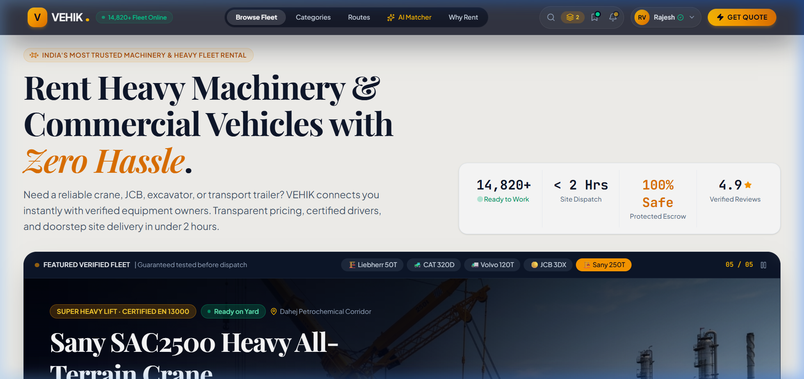

# 🚜 VEHIK — Commercial Vehicle & Heavy Equipment B2B Marketplace

<div align="center">



[](https://react.dev/)
[](https://vite.dev/)
[](https://tailwindcss.com/)
[](#-license--attribution)
[](https://nodejs.org/)
[](#-available-npm-scripts)

**An institutional frontend marketplace prototype connecting EPC contractors, infrastructure developers, and industrial plants with heavy construction machinery and commercial fleet owners across India's key freight corridors.**

[Features](#-key-features--capabilities) • [User Roles & Workflows](#-user-roles--operational-workflows) • [Simulated vs Real Integrations](#-simulated-features-vs-real-integrations) • [Data Persistence](#-state-persistence--localstorage-architecture) • [Screenshots](#-portfolio-screenshot-gallery) • [Installation](#-installation--local-setup) • [Scripts](#-available-npm-scripts) • [Limitations & Roadmap](#-current-limitations--future-roadmap)

---

</div>

## 📌 Problem Statement & Target Users

### The Problem
Large-scale infrastructure and industrial engineering projects (highways, metro rail, petrochemical refineries, solar parks, and port expansions) frequently suffer catastrophic delays due to a fragmented, offline machinery rental ecosystem:
- **Unverified Equipment Fitness:** Lack of verified load charts, expired RTO fitness cards, and uninspected hydraulic systems cause fatal jobsite accidents.
- **Opaque Pricing & Middlemen:** Offline brokers charge 20–35% markups with zero price transparency or SLA guarantees.
- **Idle Fleet Capacity:** Fleet owners experience low asset utilization across transit corridors while machines sit idle in yards.
- **Specification Mismatches:** Site engineers struggle to translate technical tender specs (tonnage, boom reach, axle loads) into readily available machine configurations.

### Target Users
1. **EPC Contractors & Project Managers (Renters):** Need vetted, certified machinery delivered to active project sites with predictable shift tariffs and zero mobilization downtime.
2. **Heavy Fleet Owners & Logistics Providers (Suppliers):** Need consistent asset utilization, transparent quote negotiation, and direct client visibility across industrial belts.
3. **Operations & Compliance Administrators:** Need to audit provider credentials, review inspection certificates, and oversee platform transactions.

---

## ⚡ Key Features & Capabilities

### 1. 🏗️ Comprehensive Heavy Fleet Catalog & Filter Engine
- **Multi-Axis Dynamic Filtering:** Filter by asset class (Hydraulic Cranes, Lowbed Trailers, Excavators, Backhoes, Mining Tippers, Prime Movers), corridor hubs, rated tonnage capacity, operator inclusion, fuel terms, and load chart validity.
- **Instant Search:** Full-text keyword search across make, model, registration code, provider name, and specifications with memoized rendering.
- **Shift Tariff Breakdown:** Transparent base shift rates (8-hr shifts), hourly meter rates, loaded kilometer tariffs, and volume duration discounts (6% for 5+ shifts, 12% for 10+ shifts, 18% for 20+ shifts).

### 2. 🛣️ Industrial Corridor & Standby Depot Tracker
- Dedicated logistics visibility across high-volume transit nodes:
  - **Sanand - Ahmedabad:** Anchor auto-manufacturing cluster with high-speed crane dispatch.
  - **Mundra Port Siding:** Maritime freight and coal sidings for heavy ODC trailers.
  - **JNPT Navi Mumbai Terminal:** Container gateway and heavy transport corridor.
  - **All Corridors (Pan-India):** Complete nationwide active registry.

### 3. 🤖 Natural Language Equipment Matcher (AI Matcher Simulator)
- Translates unformatted engineering tender clauses or jobsite descriptions (e.g., *"Need a 50 Ton all-terrain crane at Sanand Phase II with rigger crew for 4 days"*) into structured technical parameters.
- Client-side heuristic rule extractor identifies tonnage, category, corridor, and shift duration to immediately surface matching fleet candidates.

### 4. 🛡️ Institutional Inspection & Safety Audit Viewer
- Interactive technical audit certificates displaying institutional benchmarks:
  - **Load Moment Indicator (LMI):** Status and calibration tolerance (PAT Hirschmann).
  - **Hydraulic System:** Relief valve peak pressure (PSI/Bar) and leakage tests.
  - **Wire Ropes & Rigging:** Non-destructive magnetic wire rope test status.
  - **Regulatory Compliance:** RTO fitness validity, ARAI certification, and crane rigger credentials.

### 5. ⚖️ Multi-Machine Side-by-Side Comparison
- Compare up to 4 machines simultaneously across boom length, horsepower, shift rates, GPS telematics, and operator terms.

### 6. 🧮 Fleet Owner Utilization & Yield Calculator
- Interactive monthly revenue gain simulator for equipment providers based on idle reduction, fleet size, and prevailing market tariffs.

### 7. 📱 Fully Responsive Mobile Architecture
- Native-like bottom navigation dock (`Browse`, `Categories`, `RFQ`, `Routes`, `AI Match`) optimized for field engineers on mobile and tablet screens.

---

## 👥 User Roles & Operational Workflows

VEHIK provides three distinct persona workspaces accessible via the top navigation Role Switcher:

### 1. 🏗️ EPC Contractor / Customer Persona (`usr-cust-01` / Darshan Patel)
* **Discover:** Browse catalog, apply corridor filters, or enter tender requirements into the AI Matcher.
* **Inspect:** Open technical inspection audit certificates and compare machines side-by-side.
* **Request:** Submit instant Bookings or Quick RFQs with jobsite location, shift duration, rigger crew, and turnkey fuel.
* **Manage:** Review request statuses (`PENDING_QUOTE`, `QUOTE_RECEIVED`, `CONFIRMED`, `COMPLETED`), release simulated escrow milestones, and write equipment reviews.

### 2. 🚛 Fleet Owner / Provider Persona (`prov-01` / Gujarat Heavy Lifting)
* **Fleet Isolation:** Providers see exclusively their own fleet listings (e.g. `prov-01` through `prov-04`).
* **Manage Fleet:** Add new machines via the Register Fleet modal, pause/resume units, or duplicate existing listings.
* **Quote Negotiation:** Review incoming customer RFQs, submit custom tariff quotes, or confirm bookings.
* **Yield Planning:** Access the Fleet Yield Calculator to forecast utilization ROI.

### 3. 🛡️ Operations Command / Admin Persona
* **Provider Audit & Verification:** Dynamic verification metrics (`4 / 4 Verified`) with interactive audit toggle controls.
* **Listing Moderation:** Audit individual machine certificates and pause non-compliant units platform-wide.
* **Audit Trail:** Review real-time marketplace logs across all platform RFQs, bookings, and customer trust ratings.

---

## 🔍 Simulated Features vs. Real Integrations

As a frontend portfolio prototype, VEHIK accurately replicates enterprise business logic on the client side while being transparent about its simulation boundaries:

| Feature | In-App Implementation (Simulation) | Production Requirement (Real Backend) |
|:---|:---|:---|
| **Authentication & RBAC** | Client-side persona switcher stored in `localStorage.getItem("vehik_user")`. | OAuth2 / OIDC authentication with signed JWTs, secure httpOnly cookies, and server-enforced role claims. |
| **Data Persistence** | Browser `localStorage` with JSON validation and graceful mock fallbacks. | Relational database (e.g., PostgreSQL with PostGIS for corridor geofencing) accessed via REST/GraphQL API. |
| **AI Requirement Parser** | Fast client-side regex & heuristic extraction matching pre-seeded parameters. | Production LLM pipeline (e.g., Google Gemini API) with structured JSON output and prompt guardrails. |
| **Escrow & Tariffs** | State progression (`NOT_FUNDED` $\rightarrow$ `ESCROW_HOLD` $\rightarrow$ `ADVANCE_RELEASED` $\rightarrow$ `SETTLED`). | Payment gateway integration (e.g., Razorpay Escrow / Cashfree) with banking webhooks and automated tax invoices. |
| **GPS & Telematics** | Static corridor distances and standby dispatch estimates. | Hardware CAN-bus / OBD-II IoT streaming via MQTT or WebSockets with live geospatial maps. |
| **Safety Inspections** | Institutional inspection modal with seeded TÜV/ARAI checklists. | Document verification pipeline with automated OCR on RTO VAHAN and government GSTIN portals. |

---

## 💾 State Persistence & LocalStorage Architecture

VEHIK uses the browser Web Storage API with strict defensive parsing to guarantee data integrity across page refreshes without requiring a backend server:

* **Storage Keys Managed:**
  - `vehik_user`: Current active demo persona and role (`customer`, `provider`, `admin`).
  - `vehik_listings`: Active equipment registry including user-added, paused, and audited listings.
  - `vehik_providers`: Fleet provider profiles and verification audit flags.
  - `vehik_requests`: Platform RFQs, booking submissions, custom provider quotes, and escrow states.
  - `vehik_reviews`: Verified customer ratings and contractor feedback.
  - `vehik_favorites`: Customer bookmarked machinery IDs.
* **Defensive Parsing Strategy:**
  - Every `localStorage.getItem` call is wrapped in a `try...catch` block.
  - Data shape is strictly verified (`Array.isArray(parsed)`) before state assignment.
  - Corrupted, null, or malformed JSON gracefully falls back to the clean seed data in `src/data/mockData.js`, completely preventing white-screen crashes.

---

## 📸 Portfolio Screenshot Gallery

The following high-resolution screenshots reflect the live application across its core workflows:

| Screen | Preview File | Description |
|:---|:---|:---|
| **01** | [`portfolio_01_marketplace_home.png`](screenshots/portfolio_01_marketplace_home.png) | Homepage hero with industrial branding, value metrics, and quick search console. |
| **02** | [`portfolio_02_machinery_catalog.png`](screenshots/portfolio_02_machinery_catalog.png) | Machinery catalog with category tabs, spec badges, and multi-parameter filters. |
| **03** | [`portfolio_03_corridor_routes.png`](screenshots/portfolio_03_corridor_routes.png) | Transport Corridors page featuring Western freight artery hubs (Sanand, Mundra, JNPT). |
| **04** | [`portfolio_04_ai_matcher.png`](screenshots/portfolio_04_ai_matcher.png) | AI-Powered Requirement Matcher parsing tender clauses into matching candidates. |
| **05** | [`portfolio_05_customer_dashboard.png`](screenshots/portfolio_05_customer_dashboard.png) | Customer Portal showing active bookings, request status tags, and escrow controls. |
| **06** | [`portfolio_06_provider_dashboard.png`](screenshots/portfolio_06_provider_dashboard.png) | Fleet Owner Console showing owned fleet units, incoming RFQs, and custom quote tools. |
| **07** | [`portfolio_07_admin_dashboard.png`](screenshots/portfolio_07_admin_dashboard.png) | Operations Command showing verified provider metrics (`4 / 4 Verified`) and moderation log. |

---

## 🛠️ Tech Stack

* **Framework:** [React 19](https://react.dev/) (`^19.0.1`) — Modern functional components, hooks, concurrent features.
* **Build Tool:** [Vite 8](https://vite.dev/) (`^8.3.0`) — Lightning-fast development server and optimized Rollup production bundling.
* **Styling:** [Tailwind CSS v4](https://tailwindcss.com/) (`^4.3.3`) with `@tailwindcss/vite` — Industrial design system with HSL colors and responsive utilities.
* **Code Splitting:** Native `React.lazy` and `Suspense` for asynchronous route loading (reducing initial JS payload by 21.8%).
* **Iconography:** [Lucide React](https://lucide.dev/) (`^0.546.0`) — Clean, lightweight SVGs for industrial UI.
* **Language & Types:** JavaScript (ESNext) with TypeScript (`tsconfig.json`) for strict IDE and compile-time type-checking.

---

## 🚀 Installation & Local Setup

### Prerequisites
- **Node.js**: `v18.0.0` or higher (`v20+ LTS` recommended)
- **npm**: `v9.0.0` or higher

### Step 1: Clone the Repository
```bash
git clone https://github.com/Bdarshan3007/vehik-heavy-equipment-marketplace.git
cd vehik-heavy-equipment-marketplace
```

### Step 2: Install Dependencies
```bash
npm install
```

### Step 3: Configure Environment Variables
Copy `.env.example` to create `.env.local` (optional):
```bash
cp .env.example .env.local
```

### Step 4: Run Development Server
```bash
npm run dev
```
Open `http://localhost:3000` in your browser.

---

## 📜 Available npm Scripts

Verified directly from [`package.json`](./package.json):

| Command | Script | Description |
|:---|:---|:---|
| `npm run dev` | `vite --port=3000 --host=0.0.0.0` | Starts the local Vite development server on port 3000. |
| `npm run build` | `vite build` | Compiles the production application bundle to `dist/`. |
| `npm run preview` | `vite preview` | Previews the built production app locally. |
| `npm run clean` | `rm -rf dist server.js` | Removes previous build artifacts. |
| `npm run lint` | `vite build` | Validates bundle compilation and transforms without errors. |
| `npx tsc --noEmit` | `tsc --noEmit` | Executes TypeScript type checking across all files. |

> **Note on Automated Testing:** No automated test runner (e.g. Vitest or Jest) is currently installed in `package.json`. Verification is performed using production compilation, TypeScript type checks, and manual E2E browser test flows.

---

## ⚠️ Current Limitations & Future Roadmap

### Current Limitations
1. **Client-Scoped Storage:** Data modified in one browser is stored in local storage and does not synchronize with other devices.
2. **5MB Storage Limit:** Browser `localStorage` is restricted to ~5MB, which is suitable for text records but cannot store large binary file uploads.
3. **Simulated Authentication:** Session switching is instantaneous for demonstration purposes and does not enforce cryptographic password hashes or multi-factor authentication.

### Future Roadmap
- [ ] **Backend Database Integration:** Connect to Supabase or PostgreSQL with PostGIS for genuine geospatial fleet queries.
- [ ] **Live Telematics WebSockets:** Integrate CAN-bus telemetry feeds for real-time asset tracking.
- [ ] **Payment Gateway Escrow:** Integrate Razorpay or Cashfree Escrow APIs for automated milestone payouts.
- [ ] **Automated Test Suite:** Add Vitest and Playwright for continuous integration testing.

---

## 📄 License & Attribution

This project is licensed under the **MIT License**.  
Design assets, layout tokens, and equipment specifications are customized for Indian industrial corridors and heavy EPC infrastructure logistics.

---

<div align="center">

**VEHIK** — *Engineering the Digital Backbone of Heavy Infrastructure Logistics.*

</div>
